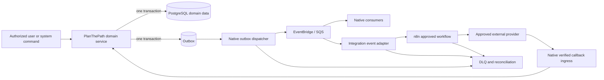

# Automation event architecture

## Architectural boundary

PlanThePath owns facts, authorization, business decisions, templates, consent/preferences, and audit. n8n may orchestrate an approved external side effect after receiving a minimum-data event or calling a typed integration adapter. A workflow result is not a domain fact until a native PlanThePath command verifies the workload, freshness, authorization, idempotency, and invariant.



n8n has no route to PostgreSQL and no authority to query a student, applicant, institution, assessment, readiness, application or document aggregate.

## Native-versus-n8n decision rule

| Concern | Native PlanThePath | n8n permitted? |
| --- | --- | --- |
| Domain validation and state transition | Always | No |
| Authentication, authorization, consent and purpose | Always, evaluated at action time | May consume a pre-authorized command reference; cannot decide |
| Scoring, readiness, eligibility, matching and ranking | Always deterministic/versioned; AI advisory only | No |
| Tenant-scoped query or aggregate report | Always | Delivery of an already produced artifact only |
| Recipient resolution, preferences and templates | Native notification service | Delivery adapter may receive minimum rendered content or an opaque command |
| External SaaS connector and multi-step delivery | Native when security-sensitive or simple; otherwise optional | Yes, after allowlist and review |
| Provider callback verification | Native ingress | No generic n8n webhook |
| Long-lived human/domain workflow | Native state machine | May mirror tasks or notifications, never become truth |
| Migration, backfill or projection rebuild | Native jobs with manifests | No |
| Raw document or answer processing | Native quarantined pipeline | No raw payload in workflow state; optional provider reference adapter only |

## Event envelope

All events use a versioned envelope. The schema is validated before publication and again before consumption.

```json
{
  "event_id": "uuid",
  "event_type": "assessment.due_soon.v1",
  "occurred_at": "RFC-3339 UTC timestamp",
  "producer": "assessment-service",
  "aggregate_type": "assessment_assignment",
  "aggregate_id": "uuid",
  "aggregate_version": 7,
  "tenant_id": "uuid-or-null",
  "subject_id": "opaque-uuid-or-null",
  "correlation_id": "uuid",
  "causation_id": "uuid-or-null",
  "purpose": "assessment-reminder",
  "data_classification": "restricted",
  "schema_ref": "registry://assessment.due_soon/1",
  "expires_at": "RFC-3339 UTC timestamp",
  "payload": {
    "assignment_id": "uuid",
    "notification_command_id": "uuid"
  }
}
```

Rules:

- Event names are past-tense facts or explicitly scheduled conditions, never imperative promises that a side effect occurred.
- Versions are part of the type. Consumers declare compatible versions; breaking changes create a new version and coexist during migration.
- Payloads contain canonical opaque IDs and reason codes, not names, emails, resumes, answers, raw prompts, access tokens or broad aggregate snapshots.
- `tenant_id`, `purpose`, classification and expiry are mandatory where applicable and are enforcement inputs, not decorative metadata.
- The event is signed/authenticated by broker workload identity; individual event HMAC is added when crossing a trust boundary.

## Event catalog

| Event | Native producer | Native consumers | Automation use | Minimum payload | Idempotency key / authorization | Observability and retention |
| --- | --- | --- | --- | --- | --- | --- |
| `identity.invitation.accepted.v1` | Identity/organization | Membership projection, audit | Optional welcome notification | invitation, user, organization IDs | Event ID; recipient resolved with current account state | Count accepted/suppressed; retain audit per policy |
| `institution.relationship.changed.v1` | Organization | Authorization projections | Cancel future institution notifications/reports on revoke/transfer | relationship ID, status, effective time | Aggregate version; consumers re-check relationship semantics | Revocation propagation SLO and failures |
| `employer.applicant_access.changed.v1` | Employer access | Authorization projections | Stop pending employer integrations when grant expires/revokes | grant/opportunity IDs, status, effective time | Aggregate version; no applicant data in automation event | Grant-revocation propagation and reconciliation |
| `profile.updated.v1` | Profile | Readiness/roadmap invalidation | No default external side effect | profile version and changed-field categories | Event ID; consumers use authorized internal read | Avoid retaining changed values in event log |
| `learning.lesson.completed.v1` | Learning | Evidence/readiness/roadmap | Optional achievement notification | activity/evidence/lesson-version IDs | Evidence ID; authorized subject command | Projection lag, duplicate suppression |
| `assessment.assigned.v1` | Assessment | Notification scheduler | Schedule invitation/due reminders | assignment and notification-command IDs, due time | Assignment version; preferences checked at send time | Scheduling lag and outstanding reminders |
| `assessment.due_soon.v1` | Notification scheduler | Notification | Deliver reminder | assignment and notification-command IDs | Notification command ID; current status/preferences rechecked | Sent/suppressed/failed/lateness |
| `assessment.submitted.v1` | Assessment | Scoring/readiness/audit | Optional submission receipt | attempt/evidence/content-version IDs | Attempt version; subject authorization already recorded | Submission-to-projection SLO |
| `readiness.snapshot.created.v1` | Readiness | Roadmap, authorized analytics | Optional “plan updated” notice, not score disclosure | snapshot/model IDs and material-change flag | Snapshot ID; recipient authorization at delivery | Model version, compute lag, no score in external event |
| `roadmap.task.created.v1` | Roadmap | Notification scheduler | Optional new-task message | task and policy-version IDs, due time | Task version; current subject/preference check | Creation/scheduling lag |
| `roadmap.task.due_soon.v1` | Scheduler | Notification | Reminder delivery | task and notification-command IDs | Command ID; task status rechecked | Delivery and suppression metrics |
| `roadmap.task.overdue.v1` | Scheduler | Notification, authorized institution intervention | Digest/escalation under explicit policy | task ID, overdue band, command ID | Task/version/band; relationship/purpose rechecked | Escalation count and access denials |
| `roadmap.task.completed.v1` | Roadmap | Readiness/notification | Cancel reminders; optional acknowledgement | task/evidence IDs | Task version | Cancellation propagation |
| `content.review.requested.v1` | Content governance | Review queue | Optional external task mirror | revision/review IDs, SLA time | Review ID; assignee resolved natively | Queue and assignment latency |
| `content.review.overdue.v1` | Governance scheduler | Escalation service | Approved work-system alert | review ID, escalation level, command ID | Review/version/level | SLA, duplicate and reconciliation metrics |
| `content.release.published.v1` | Content governance | Learning/assessment caches | Operational release notice | release ID, manifest hash | Release ID/hash | Activation, cache convergence, rollback readiness |
| `opportunity.published.v1` | Opportunity | Matching/search | Optional preference-aware notification | opportunity/version IDs, category codes | Event ID; native matching and consent | Match/notify lag; no candidate data in event |
| `application.status.changed.v1` | Application | Notification/audit | Applicant status notification | application/version/status code, command ID | Aggregate version; applicant and employer scope rechecked | Ordering, sent/suppressed/failed |
| `interview.scheduled.v1` | Interview | Notification and integration adapter | Calendar/meeting provisioning and invite | interview/version, participant refs, command refs | Provider command per participant/version; scheduler authority recorded | Provider latency, result, duplicate/compensation |
| `interview.rescheduled.v1` | Interview | Notification/integration | Update event/meeting and send update | interview/version, previous provider command ref | New version supersedes old; provider reconciliation | Ordering and stale-update rejections |
| `interview.cancelled.v1` | Interview | Notification/integration | Cancel external event and reminders | interview/version, cancellation command refs | New aggregate version; current external mapping | Cancellation SLO and orphan scan |
| `document.uploaded.v1` | Document | Malware scan orchestrator | No n8n | document version, quarantine object ref | Document/version; service role scoped to prefix | Scan queue, age and failures |
| `document.scan_completed.v1` | Document security | Extraction orchestrator | Optional managed extractor adapter | document version, clean/quarantined status, opaque object ref | Scanner result ID; only clean status advances | Scan result, callback signature, retention |
| `document.extraction.completed.v1` | Document/AI gateway | Owner confirmation UI | Optional completion notification | document/extraction/model IDs, status | Extraction version; current owner access | Cost, schema validity, confirmation rate |
| `report.ready.v1` | Authorized report service | Notification | Deliver expiring artifact link | report/version, recipient command ID | Report/recipient/version; relationship rechecked | Generation/delivery/expiry metrics |
| `notification.delivery.requested.v1` | Notification | Delivery adapter | n8n or native provider delivery | command, template version, opaque destination ref | Notification command ID | End-to-end delivery trace |
| `notification.delivered.v1` | Verified provider callback/projector | Notification projection | None | command/provider event IDs, time | Provider event ID; signature and mapping | Provider SLO and duplicate callbacks |
| `notification.delivery.failed.v1` | Delivery adapter/callback | Retry/reconciliation | Operations escalation after threshold | command, provider error class, attempt | Command/attempt; bounded retry policy | Failure class, age, DLQ depth |
| `security.alert.raised.v1` | Security services | SOC/on-call | Secondary routing | alert ID, severity, category, runbook ref | Alert ID/fingerprint; trusted producer only | Acknowledgement and paging SLO |
| `outbox.delivery.failed.v1` | Dispatcher | Platform operations | Route incident | outbox ID, event type, failure class, attempt | Outbox/attempt; trusted producer | DLQ depth, oldest age, replay outcome |

## Transactional outbox and dispatcher

The existing outbox table is retained and extended operationally, not bypassed.

1. Domain state, audit record, and outbox row commit in one transaction.
2. A native dispatcher claims rows using a lease/attempt protocol suitable for concurrent workers.
3. It validates the registered schema, applies data-classification policy, and publishes to an environment-specific broker destination using workload identity.
4. It records publish outcome without losing the original event. Retries use exponential backoff with jitter and a finite attempt/age budget.
5. Poison or expired events move to a DLQ/quarantine with reason codes. Replay is an audited operator action using the same event ID.
6. Consumers persist `(consumer, event_id)` before or atomically with their effect. “At least once” transport must yield effectively-once domain behavior.
7. A reconciliation job compares outbox, broker, consumer and provider states and surfaces gaps.

## Notification command pattern

Domain events do not contain an email address or final message. A native notification policy consumes the fact and creates a `notification_command` after checking:

- current aggregate state and authorization;
- recipient ownership/relationship;
- purpose and legal basis;
- channel consent/preferences, quiet hours and frequency caps;
- approved localized template version; and
- dedupe/idempotency policy.

The delivery adapter receives the command reference. Prefer resolving the address and rendered content within a native provider adapter. If n8n must receive rendered data, scope it to one message, encrypt transport, prohibit persistence beyond the short execution window, and log only metadata.

## Inbound callback pattern

External providers call a native ingress endpoint behind rate limiting and WAF controls. The endpoint:

1. reads a strictly bounded body;
2. verifies provider signature, timestamp and endpoint/account identity against secret-manager material;
3. rejects stale or replayed provider event IDs;
4. maps the external account/resource to an expected PlanThePath integration;
5. writes the raw evidence to a restricted short-retention store only when required;
6. submits a typed command to the owning domain; and
7. records audit and outbox outcome.

An n8n webhook is not the trust terminator for payment, identity, application, interview, email-delivery, document, or security callbacks.

## n8n adapter contract

The integration adapter issues a short-lived, audience-bound workload token and a command containing:

- workflow allowlist ID and version;
- event/notification/provider-command ID;
- permitted operation and destination class;
- minimum payload or one-time fetch reference;
- expiry and maximum attempts; and
- correlation and idempotency IDs.

n8n may report `accepted`, `succeeded`, `failed_retryable`, `failed_terminal`, or `expired` to a typed native endpoint. It cannot submit arbitrary domain commands. A success report must include the provider reference and reviewed result schema; it never proves that a domain transition is authorized.

## Ordering, replay and cancellation

- Consumers compare `aggregate_version`; stale state-change events are ignored or reconciled.
- Notification commands are immutable. A cancellation/supersession command suppresses an unsent command and compensates an external artifact when supported.
- Replays keep the same event ID and side-effect idempotency key.
- Provider operations include the PlanThePath idempotency key when the provider supports it; otherwise the external-ID mapping is locked and checked before creation.
- Expired events do not execute. A native service decides whether a fresh command is warranted.

## Observability contract

Metrics must connect domain command → outbox → broker → consumer/adapter → n8n execution → provider → callback/reconciliation through correlation IDs without logging protected payloads.

Required signals include outbox oldest age, dispatch latency/failures, broker/DLQ depth, consumer lag/duplicates, workflow executions by outcome/version, provider latency/error class, callback signature/replay failures, notification suppression, and unresolved reconciliation items. Alerting has an independent path so a failed n8n instance cannot hide its own failures.
