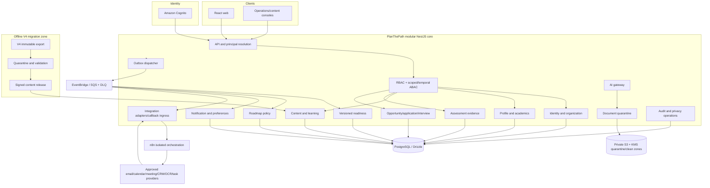

# Target architecture after integration

## Outcome

The target is one PlanThePath platform, not a federation of the current application, V4, and n8n. PostgreSQL/domain services remain authoritative. V4 supplies curated source material through an import boundary. n8n supplies optional external connector orchestration behind an event and adapter boundary.

## Architecture principles

1. **One source of truth:** each aggregate has one native owner and canonical PostgreSQL representation.
2. **Commands protect invariants:** external results enter through typed commands with current authorization, not direct tables or generic webhooks.
3. **Evidence before projection:** activity/attempt evidence is immutable; score/readiness/roadmap views are versioned and rebuildable.
4. **Events are least-data facts:** the transactional outbox supplies versioned facts; consumers are idempotent and observable.
5. **External automation is replaceable:** n8n cannot own domain state, recipient policy, scoring, consent, or a long-lived business process.
6. **Content is a supply chain:** source/provenance/license/review/release are first-class data.
7. **AI is advisory:** controlled gateway, structured results, evidence/version links and human confirmation.
8. **Privacy follows every copy:** purpose, classification, retention, access and deletion apply to events, logs, workflow executions and providers.

## Module ownership

| Module | Owns | Does not delegate to V4/n8n |
| --- | --- | --- |
| Identity/organization | Internal account, organization/unit, membership/scope, invitations, temporal relationships, employer grants | Credentials, grants, role decisions |
| Profile/academics | Field-level profile, preferences, attestations, visibility and provenance | Profile inference or external copies by default |
| Content governance | Sources, licenses, taxonomy, revisions, quality gates, reviews, release manifests | Publication decisions |
| Learning | Lessons, prerequisites, activities and progress projection | Progress mutation from an external workflow |
| Assessment | Blueprints, assignments, attempts, answers, evidence and protected answer keys | Selection/scoring in n8n |
| Readiness | Model registry, immutable snapshots, explanations and rebuilds | V4 scores or AI judgments |
| Roadmap | Versioned policies, recommendations, tasks and replanning | Generic scheduled-task system as truth |
| Documents | Object metadata, upload authorization, quarantine, scan, retention and sharing | Local files or raw-document workflow persistence |
| AI gateway | Provider/prompt/model policy, schema validation, advisory result and human state | Direct model nodes using product credentials |
| Opportunity/application/interview | Employer content, applicant state, consent/access, scheduling and feedback | CRM/calendar as truth; AI ranking |
| Notification | Templates, preferences, recipient/purpose policy, command and delivery projection | Recipient selection or quiet-hours logic in n8n |
| Integration | Provider command, workload auth, field maps, verified callback and reconciliation | Arbitrary domain endpoints or database access |
| Audit/privacy | Decision evidence, correlation, retention, export/delete/restriction/legal hold | Workflow logs as the audit system |

## Canonical data patterns

### Versioned content

Published learning and assessment entities are immutable versions. A release manifest binds exact versions, provenance, license evidence, review decisions and checksums. Attempts always reference the version shown to the learner. Retiring a release changes future selection, not history.

### Immutable evidence and rebuildable projections

Learning completion, assessment submission and verified document/profile actions create evidence records. Topic mastery, readiness and roadmap projections store the evidence set and model/policy version used. A correction appends/supersedes evidence and triggers a new projection; it does not edit historical conclusions in place.

### Temporal and purpose-aware access

Every restricted query/command combines actor, role, organization, scope/resource ownership, relationship/grant validity, purpose and time. Employer access also binds to the specific opportunity/application and explicit allowed data. An event never creates a durable authorization shortcut.

### Integration state

Provider mappings and commands are native records:

- integration/provider/account and tenant mapping;
- provider command with operation, aggregate version, payload class, idempotency key and expiry;
- external resource ID and last reconciled version;
- callback/provider event ledger;
- status, attempts, error class and next action; and
- audit/correlation IDs.

n8n gets a constrained command view, not general application APIs.

## V4 integration boundary

V4 is absent from the runtime diagram. Its data crosses only through:

1. immutable export and evidence capture;
2. offline structural/license/quality validation;
3. human review and signed release;
4. PlanThePath staging/import commands; and
5. native projection rebuilds.

The mapping registry preserves source identifiers and transformations. It never turns a V4 integer ID into a public/canonical identity. Raw source packages and rejected/quarantined content are access-controlled and retained only as policy requires.

## Event and automation boundary

The current outbox becomes an operational subsystem with dispatch leases, schema validation, EventBridge/SQS publication, DLQ, replay and reconciliation. Native consumers update projections and create notification/provider commands. The integration adapter exchanges short-lived, audience-bound commands with n8n.

n8n runtime requirements:

- private network and separate database/account;
- no route or credential to canonical PostgreSQL;
- source-controlled signed workflow versions;
- first-party node and egress allowlists;
- secrets from a manager with per-workflow least scopes;
- minimum execution persistence and short retention;
- independent metrics/alerts and a global/per-workflow kill switch; and
- production changes promoted through CI/CD, not edited ad hoc.

## Document and AI flow

1. Native service authorizes a presigned upload to a quarantine prefix.
2. The object is checked for size/type/checksum and malware; only a clean immutable version advances.
3. A native extraction/AI command references the object and approved purpose/provider policy.
4. The AI gateway provides bounded, untrusted input and requires a structured schema; it does not expose tools with domain authority.
5. Results store provider/model/prompt/rubric/evidence versions, confidence and safety status.
6. The student or authorized operator reviews/corrects the advisory result before a profile/document state transition.
7. Original and derived objects follow retention, export/delete and sharing policy.

## End-to-end example: assessment reminder

1. An authorized native command creates an assignment plus audit and outbox record.
2. The scheduler produces a due condition; notification policy rechecks assignment status, recipient, preferences, quiet hours and frequency.
3. It creates one immutable notification command and outbox event.
4. The adapter sends a minimum command to a pinned n8n workflow or native provider adapter.
5. The provider uses the command ID as idempotency metadata where supported.
6. A signed callback enters PlanThePath, updates delivery projection and emits a delivery fact.
7. Reconciliation detects a missing/stale provider result; replay retains the same side-effect key.

The message workflow never reads assessment tables and never receives questions, answers, readiness or unrelated profile fields.

## Availability and recovery

- Domain commands succeed independently of temporary n8n/provider failure once the outbox transaction commits.
- Queues absorb bounded outages; events have explicit expiry and retry budgets.
- DLQs and reconciliation make failures visible and recoverable.
- Notification/integration failures do not roll back authoritative domain facts.
- Disabling n8n stops optional side effects without disabling core learning, assessment, readiness, application or identity operations.
- Content release rollback changes the active manifest pointer; immutable historical references remain valid.

## Observability and audit

Every command/event/workflow/provider interaction carries event, correlation, causation, tenant and aggregate identifiers as applicable. Logs exclude payloads by default. Dashboards cover outbox age, consumer lag, DLQ, workflow outcomes/version, provider latency/failure, callback verification, reconciliation backlog, migration gate results and content-release health.

Audit captures the human/service actor, authority/purpose, resource, decision, policy/model/workflow version, source manifest, result and reason codes. n8n execution history is operational telemetry and is never the authoritative audit ledger.

## Architecture decisions retained

The integration does not reopen these approved constraints:

- modular NestJS core rather than a V4 service or premature microservices;
- PostgreSQL/Drizzle rather than SQLite or a second domain database;
- Cognito rather than local credentials;
- RBAC plus scoped/temporal ABAC rather than global legacy roles;
- transactional outbox and broker rather than database polling by n8n;
- deterministic versioned readiness rather than AI or legacy fixed scores; and
- private AI/document processing with explicit user control.

Product decisions still required are isolated in [DECISIONS_REQUIRED.md](DECISIONS_REQUIRED.md).
