# V4 data migration strategy

## Objective

Migrate only V4 data that is legally reusable, product-approved, reproducible, high quality, and compatible with PlanThePath's canonical architecture. The process must preserve source evidence, make every transformation repeatable, and allow rejection or rollback without affecting production records.

This strategy is not authorization to import data. It defines the gates a later implementation must pass.

## Non-negotiable rules

1. Never connect a migration job to the V4 SQLite file and production PlanThePath database at the same time.
2. Never copy V4 tables into the production schema or preserve V4 integer IDs as canonical IDs.
3. Never migrate password hashes, sessions, MFA/recovery secrets, access tokens, local payment state, or system settings.
4. Never migrate a readiness score, topic score, recommendation, or AI result as authoritative truth.
5. Never publish content with an unknown, contradictory, or unacceptable license or without traceable source evidence.
6. Never migrate personal data without a documented controller, lawful basis, purpose, subject/account match, retention rule, and data-subject operation plan.
7. Every run is immutable and identified by source repository commit, export manifest hash, transformation version, operator, timestamps, and result manifest.
8. All writes use PlanThePath-owned staging/import commands and service identities with least privilege. No direct domain-table insert script is accepted.

## Migration trust zones

```mermaid
flowchart LR
  A[V4 immutable export] --> B[Offline evidence store]
  B --> C[Quarantine staging]
  C --> D[Automated validation]
  D --> E[License and SME review]
  E --> F[Canonical candidate store]
  F --> G[Signed release manifest]
  G --> H[PlanThePath import commands]
  H --> I[Canonical PostgreSQL]
  I --> J[Recomputed projections]
```

- The **offline evidence store** keeps the raw export, DDL/migration list, source commit, checksums, and third-party notices. It is never served to product users.
- **Quarantine staging** has no runtime application role and no answer-key exposure. Records can fail without affecting canonical state.
- The **candidate store** contains normalized records, mapping decisions, validation results, and review state.
- A **release manifest** enumerates exact immutable versions. Production imports only a signed, approved manifest.

## Required source package

The V4 owner must provide one immutable package containing:

- the source commit and dirty-status attestation;
- an export produced by a documented command from a clean environment;
- migration/version history and tool/runtime versions;
- row counts by entity and lifecycle state;
- SHA-256 for every export file and source artifact;
- stable V4 source identifiers and parent references;
- content source, license expression, attribution and evidence per record;
- a manifest of excluded secrets, authentication records and personal data;
- duplicate/quality reports with algorithm versions; and
- expected post-import counts and referential-integrity totals.

The documented 20,320-question target and the observed incomplete 16,985-question reconstruction must be reconciled before accepting a package.

## Canonical identity and mapping

Each imported entity receives a PlanThePath UUID. A migration mapping record contains:

| Field | Purpose |
| --- | --- |
| `migration_run_id` | Immutable run identity |
| `source_system` | `V4` |
| `source_commit` | Exact repository revision |
| `source_entity_type` / `source_entity_id` | Original identity without making it canonical |
| `source_checksum` | Detect source drift and duplicate imports |
| `canonical_entity_type` / `canonical_entity_id` | PlanThePath identity after acceptance |
| `transformation_version` | Reproduce normalized output |
| `disposition` | accepted, merged, rejected, quarantined, superseded |
| `reason_codes` | Machine-readable review/validation outcome |
| `review_evidence_ids` | License, SME and quality decisions |
| `created_at` | Auditable timeline |

An import rerun with the same source checksum and transformation version is a no-op. A changed source produces a new candidate version; it never silently overwrites a published entity.

## Entity transformations

| Source group | Canonical output | Key transformations | Publish/migration gate |
| --- | --- | --- | --- |
| Colleges/degrees/branches | Organizations, units, academic reference versions | Dedupe, validate authority, normalize aliases/location/status | Organization steward approval |
| Career goals/roles | Versioned career taxonomy | Normalize aliases, lifecycle, external standard mappings | Product taxonomy owner |
| Subjects/topics/lessons | Versioned learning catalog | Localize text, canonical IDs, ordering, provenance, status | License + SME + accessibility |
| Prerequisites | Versioned graph edges | Resolve mappings; reject missing nodes, self-edge and cycles | Graph validation + content approval |
| Questions/options | Versioned protected assessment items | Normalize formats, isolate answer keys, checksum, license, difficulty and source | License + SME + duplicate + leakage gate |
| Tags/mappings/use cases | Controlled vocabulary associations | Resolve to canonical versions; enforce cardinality and primary mapping | Taxonomy and release validation |
| Blueprints | Versioned assessment definitions | Re-author sections/quotas; deterministic seeded selection; scarcity rules | Assessment owner + simulation |
| Company/interview packs | Versioned prep content | Separate generic, employer-owned and confidential items | Rights owner + security review |
| Scholarships/exams | Expiring opportunity-source candidates | Provider identity, canonical dates/regions, source URL, freshness | Approved provider + human publish |
| Personal profiles/preferences | Canonical field-level profile records | Identity match, provenance, visibility, purpose, retention | Separate privacy migration approval |
| Learning/assessment history | Immutable evidence candidates | Map subject/content versions, retain event time and source, reject unverifiable rows | Identity + evidence + authorization gate |
| Scores/snapshots/recommendations | No direct output | Retain only in offline evidence if legally required; recompute canonical projections | Target model deployed |
| Documents/resumes | Quarantined objects plus metadata | Prove ownership, checksum, malware scan, content type, retention | Separate document migration approval |
| Audit history | Canonical source-import audit subset | Redact/minimize payload; map actor only when verified | Legal retention and audit owner |

## Content pipeline

### Gate 1 — structural validation

- Files match the declared schema and checksum manifest.
- Required identifiers are unique and stable within the export.
- References resolve and lifecycle values are known.
- Text encoding, language, option cardinality, and answer-key constraints pass.
- Prerequisite and taxonomy graphs are valid.

### Gate 2 — provenance and license

- Every record has an attributable source and evidence attachment.
- SPDX-like license values are normalized but the original label is preserved.
- The license permits the intended hosted, modified, and possibly commercial use.
- Attribution and share-alike obligations are encoded in release metadata.
- `ONE Original`, missing, conflicting, or unsupported licenses stay quarantined.

### Gate 3 — quality and safety

- Exact and near duplicates are reviewed across all sources, not silently removed.
- Questions are answerable, unambiguous, accessible, and mapped correctly.
- Answer options and explanations do not contain malicious markup, secrets, or prompt-injection instructions.
- Sensitive, discriminatory, unsafe, or obsolete material is rejected or escalated.
- A statistically meaningful sample is independently reviewed per source, topic, and quality band.

### Gate 4 — product and SME approval

- An authorized subject-matter reviewer approves correctness.
- A different authorized release manager approves the manifest.
- No author approves their own blocking exception.
- Waivers have a reason, approver, scope, expiry and remediation owner.

### Gate 5 — release verification

- The signed manifest resolves to exact immutable item versions.
- Counts and hashes match the approved candidate set.
- Blueprint simulations meet coverage and scarcity constraints.
- A staging environment renders and serves items without exposing protected answers.
- Rollback to the preceding release is demonstrated.

## Personal-data migration track

Personal data is excluded from the initial content migration. If a later goal authorizes it, use a separate program with these gates:

1. **Population decision:** identify whose data is in scope and why migration benefits them.
2. **Controller and lawful basis:** document controller/processor roles, purpose, notices and transfer terms.
3. **Identity matching:** match a V4 person to a verified PlanThePath/Cognito account with deterministic evidence; ambiguous matches require subject confirmation.
4. **Field minimization:** import only fields needed for the approved purpose; never authentication secrets or local payment state.
5. **Visibility mapping:** set field-level ownership/sharing; do not infer institution or employer access from legacy roles.
6. **Evidence integrity:** retain source timestamp/version and mark confidence; unprovable progress/attempts are not authoritative.
7. **Subject control:** provide preview/correction where appropriate and support export, deletion, restriction and consent withdrawal.
8. **Downstream control:** no automation or AI processing until purpose, destination and retention policies are active.

## Assessment and readiness history

If assessment history is approved for migration, preserve it as source-labelled evidence only when the exact content version, answer, timing, actor and attempt lifecycle can be reconstructed. Otherwise import a non-authoritative historical annotation or exclude it.

PlanThePath computes topic/readiness/roadmap projections after evidence import using a published model version. The projection records:

- model and policy version;
- exact evidence IDs and content versions;
- generation time and reason codes;
- missing-data treatment;
- explanation inputs; and
- supersession/recalculation history.

V4's fixed readiness category weights, recent-attempt blending, and synthetic 100-point interview completion are not imported.

## Execution phases

| Phase | Scope | Output | Exit criteria |
| --- | --- | --- | --- |
| M0 Evidence freeze | Clean export and manifests | Immutable source package | Counts reconciled; hashes verified; no secrets |
| M1 Mapping prototype | Small, non-personal taxonomy slice | Mapping registry and transform v1 | Idempotent rerun; all rejects explained |
| M2 Content quarantine | Full candidate non-personal corpus | Validation/license/duplicate reports | No record bypasses provenance state |
| M3 Curated pilot | One subject and representative blueprints | Signed staging release | SME, security, accessibility and rollback pass |
| M4 Production content release | Approved immutable content versions | Canonical release | Observability and rollback verified |
| M5 Personal-data discovery | Inventory only; no import | DPIA/ROPA inputs and population proposal | Product/privacy/legal approval |
| M6 Personal pilot | Explicitly approved small cohort | Evidence and subject verification report | Zero unresolved identity or visibility errors |
| M7 Projection rebuild | Canonical evidence under target models | Versioned readiness/roadmap projections | Golden vectors, explanation and fairness gates |

## Validation suite

Every run produces machine-readable results for:

- source file and manifest hashes;
- per-entity input, accepted, merged, rejected and quarantined counts;
- referential integrity and graph constraints;
- mapping uniqueness and idempotent rerun;
- license/provenance completeness;
- duplicate and quality-rule outcomes;
- protected-answer isolation;
- tenant, subject, purpose and temporal authorization;
- audit/outbox atomicity for canonical import commands;
- release manifest resolution and rollback;
- data-subject export/delete/restriction coverage for any personal pilot; and
- projection reconstruction from immutable evidence.

## Failure and rollback

- Validation failure leaves records in quarantine and makes no canonical change.
- Import commands are manifest-scoped and resumable with idempotency keys.
- A failed canonical import is transactionally rolled back or compensated by a new audited command; operators never edit rows manually.
- Published content rollback switches the active release pointer to a previously verified manifest. Historical attempts continue referencing their original immutable content versions.
- Migration mappings and audit records remain even when a candidate or release is rejected, subject to approved retention rules.

## Ownership

| Responsibility | Accountable owner |
| --- | --- |
| Source package and count reconciliation | V4 repository/content owner |
| License and attribution decision | Legal/content governance |
| Canonical schemas and transformation code | PlanThePath domain engineering |
| Security and privacy gates | Security and privacy engineering |
| SME correctness and taxonomy | Product-designated content owners |
| Release approval | Content release manager, separate from author/reviewer |
| Personal-data population decision | Product owner plus privacy/legal |
| Production execution and rollback | Platform/SRE with domain owner |

## Current blockers

1. No root V4 license or established grant for repository code and `ONE Original` content.
2. Mixed Creative Commons obligations have not been evaluated for the intended distribution model.
3. The documented 20,320-question target was not independently reconstructed; a canonical export and checksums are absent.
4. PlanThePath content, assessment, readiness, roadmap, document and privacy-operation modules are not yet implemented.
5. Product owners have not approved the canonical readiness model, external content sources, personal-data population, or document/AI processing basis.
